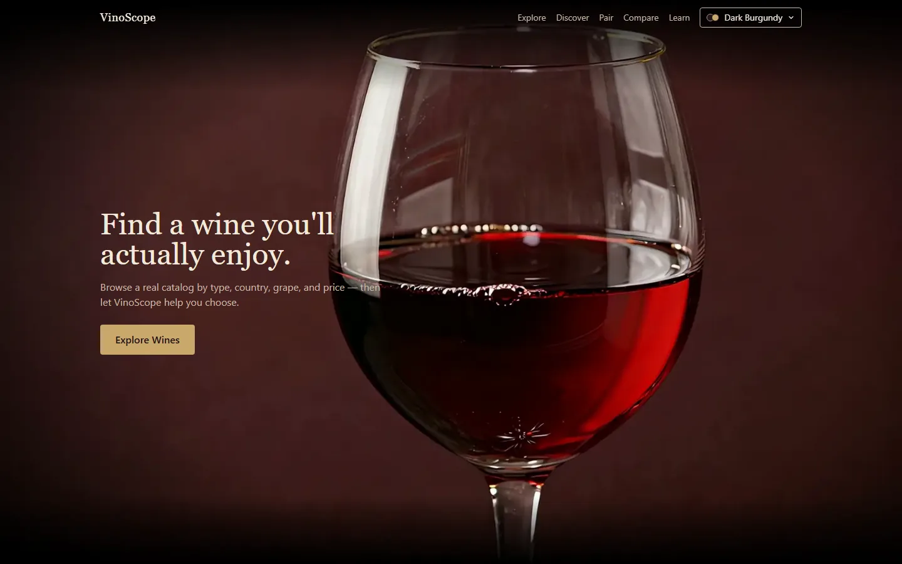
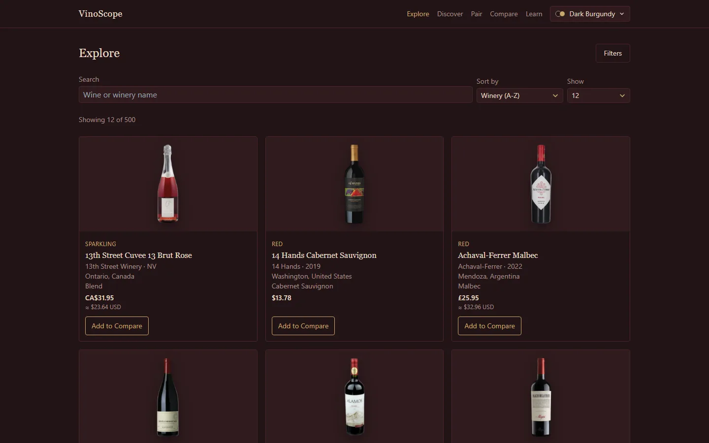
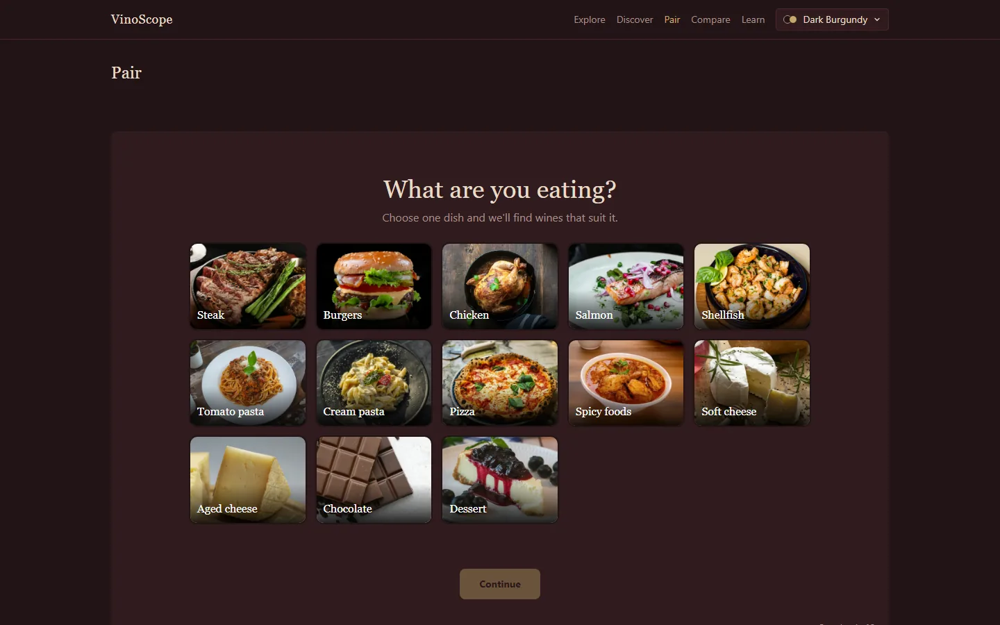
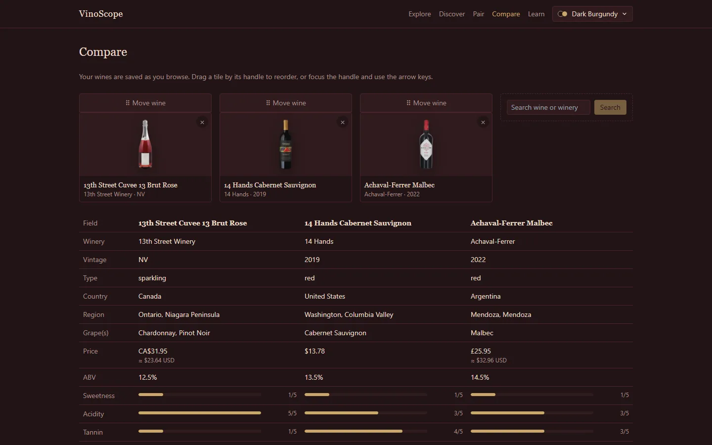
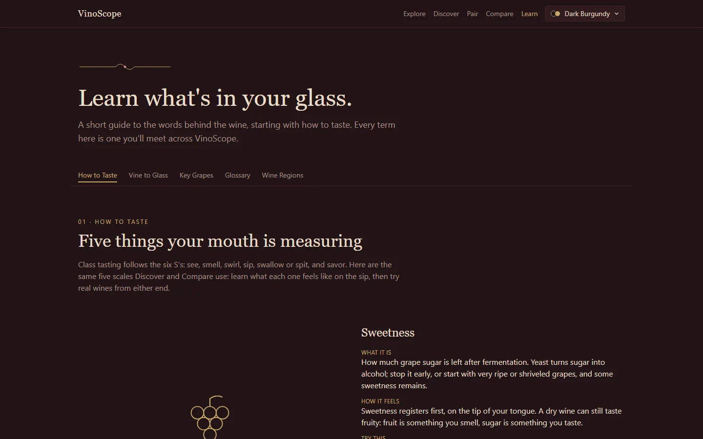

# VinoScope

**Find a wine you'll actually enjoy.** VinoScope is a wine discovery site: browse 500 real
bottles, take a short taste quiz, pick wines for dinner, compare bottles side by side, and
learn the vocabulary behind the label.

**Live site: [wines.chrisdeforest.dev](https://wines.chrisdeforest.dev)**

Built as the final project for *Wines of the World* (Fall 2026). VinoScope isn't a store:
it recommends wines and links out to retailers.



## Features

| Page | What it does |
| :--- | :--- |
| **Explore** | Search and sort all 500 wines. Filter by type, country, region, grape, price, alcohol, vintage, and taste ranges. |
| **Discover** | A one-question-at-a-time taste quiz that ranks every wine by how close it is to your answers, and explains each match. |
| **Pair** | Pick a dish, a wine type, and a budget, and get wines that suit the food. |
| **Compare** | Up to four wines side by side, with a taste radar chart. Your picks are saved as you browse. |
| **Learn** | A five-chapter guide written from the course notes: How to Taste, Vine to Glass, Key Grapes, Glossary, and an interactive Wine Regions map. |
| **Themes** | Dark Burgundy, Cream & Terracotta, and Charcoal & Gold. |

<table>
  <tr>
    <td></td>
    <td></td>
  </tr>
  <tr>
    <td></td>
    <td></td>
  </tr>
</table>

## How recommendations work

Every wine has five taste scores from 1 to 5: **sweetness, acidity, tannin, body, and
fruitiness**. Your quiz answers become a vector on the same scale, and wines are ranked by
their distance from it (root-mean-square difference, then `score = 1 / (1 + distance)`).

The important detail is **"I'm unsure" is treated as missing, not as "medium."** An unsure
answer is skipped, so the engine only compares the dimensions you actually answered:

```text
Wine: [1, 4, 5, 5, 3]
You:  [1, ?, 4, 5, ?]   ← compared on sweetness, tannin and body only
```

- If you pick several levels ("dry or off-dry"), the closest one counts.
- A wine with no data on anything you asked about ranks last instead of tying with a perfect match.
- Each result lists what matched ("Full-bodied", "High tannin") and how many of your taste factors it was compared on.
- **Pair** uses the same engine: each dish maps to a taste profile (for example, steak → high tannin, full body).

The engine is in [`backend/app/services/recommendations.py`](backend/app/services/recommendations.py).

## Tech stack

| Layer | Tools |
| :--- | :--- |
| Database | PostgreSQL 17, SQLAlchemy 2, Alembic |
| Data pipeline | Python, pandas, rapidfuzz |
| API | FastAPI, Uvicorn |
| Frontend | React 18, TypeScript, Vite, Tailwind CSS, React Router, Recharts, d3-geo |
| Tests | pytest, Vitest, Testing Library |
| Hosting | nginx + systemd on a Raspberry Pi 4, behind Cloudflare |

## Project layout

```text
backend/        FastAPI app (api/, models/, schemas/, services/) and Alembic migrations
frontend/       React app (pages/, components/, hooks/) and public assets (bottle photos, hero frames)
scripts/        Data pipeline: normalize, find duplicates, import, verify, process bottle images
data/           Source CSVs, the cleaned catalog, and the bottle image manifest
tests/          Backend and script tests (pytest)
deploy/         nginx, systemd and updater scripts for the live site (see deploy/README.md)
```

## Running it locally

You need Python 3.12+, Node 20+, and Docker (for Postgres).

### 1. Backend

```bash
cp .env.example .env              # set ADMIN_API_KEY to enable the admin write endpoints
pip install -r backend/requirements.txt
docker compose up -d postgres     # also creates the vinoscope_test database
cd backend && alembic upgrade head && cd ..
python scripts/import_wines.py data/cleaned/wines_combined_500.csv
cd backend && uvicorn app.main:app --port 8000
```

The API is now at `http://localhost:8000`, with interactive docs at `/docs`.

### 2. Frontend

In a second terminal:

```bash
cp frontend/.env.example frontend/.env
cd frontend
npm install
npm run dev                       # http://localhost:5173
```

### 3. Tests

```bash
pytest                            # backend + scripts (needs the Postgres container running)
cd frontend && npm run test       # frontend
```

## API

All routes are under `/api`.

| Method | Route | Purpose |
| :--- | :--- | :--- |
| `GET` | `/wines` | List wines with search, filters, sorting, and pagination |
| `GET` | `/wines/facets` | Filter options from the catalog: types, countries and their regions, vintage and ABV ranges |
| `GET` | `/wines/{id}` | Wine detail with grapes and retailer listings |
| `POST` | `/recommendations` | Ranked, explained recommendations for a taste profile |
| `GET` | `/admin/stats` | Catalog statistics (admin key) |
| `PATCH` | `/wines/{id}` | Edit a wine (admin key) |
| `POST` / `PATCH` / `DELETE` / `PUT` | `/wines/{id}/listings…`, `/wines/{id}/grapes` | Edit retailer listings and grapes (admin key) |

Write routes need an `X-Admin-Key` header that matches `ADMIN_API_KEY`. On the live site the
admin page and write routes are only reachable from the home network.

## Adding wines

1. Copy `data/raw/wines_template.csv` and fill in rows. Leave unknown cells blank, and use
   `NV` for non-vintage wines.
2. Normalize it:
   `python scripts/normalize_wines.py data/raw/<file>.csv data/cleaned/<file>.csv`
3. Check for duplicates, then review the output by hand:
   `python scripts/find_duplicates.py data/cleaned/<file>.csv data/cleaned/<file>.review.csv`
4. Import it (safe to re-run; existing wines are updated, not duplicated):
   `python scripts/import_wines.py data/cleaned/<file>.csv`
5. Verify: `python scripts/verify_import.py`

### Bottle images

Every wine has a transparent bottle cutout in `frontend/public/wines/`, so the bottles sit on
any theme. 475 are real producer photos. The other 25 are AI-generated with a blank label,
because an AI image should never fake a real winery's label. Each image's source is recorded
in `data/images/manifest.csv`. To process new images, install
`scripts/requirements-images.txt` and see `scripts/process_wine_images.py`.

## Deployment

The live site runs on a Raspberry Pi. Pushing to `main` deploys automatically within 15
minutes. [`deploy/README.md`](deploy/README.md) covers how updates work, what runs where,
backups, and rebuilding the server.

## How it was built

VinoScope was built in one month (September 21 – October 21, 2026) with
[Claude Code](https://claude.com/claude-code). Each feature went from a written design spec,
to a step-by-step plan, to test-first implementation, to a final review before merging. I made
the design decisions, and the AI wrote most of the code.

There's a longer write-up of the design and build on
[my blog](https://chrisdeforest.dev/blog/designing-and-building-vinoscope).
